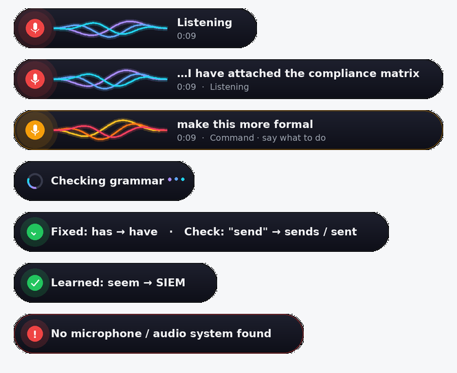

# FlowType 🎙️ — talk instead of typing (Windows · macOS · Linux)

Hold a key, speak, and your words are typed into **any app** on Windows, macOS or Linux: WhatsApp Web, Gmail, Outlook, Word, Slack, ChatGPT, Claude…
Speech recognition runs **offline on your PC** (OpenAI Whisper via faster-whisper). Free, no account needed.



## ⬇️ Install — pick one

### Windows (recommended): the installer
1. Go to **[Releases](../../releases/latest)** and download **`FlowType-Setup.exe`**.
2. Run it and click through the usual installer: *Next → Install → Finish*. It adds FlowType to the Start menu (plus a Desktop icon and start-at-sign-in if you tick those), and starts it.
   - If Windows says *"Windows protected your PC"*, click **More info → Run anyway**. That appears for every new app that isn't code-signed yet.
3. The first launch downloads the speech model (~500 MB), so wait a few minutes before your first try.
4. To uninstall: **Settings → Apps → FlowType → Uninstall**.

No admin rights needed. The installer shows the [privacy policy](PRIVACY.md) before installing. Windows builds are built automatically from this repository by GitHub Actions; code signing is being set up with SignPath Foundation (see [Code signing policy](#code-signing-policy)).

Prefer no installer? Download **`FlowType-Windows.zip`** instead, unzip it and double-click `FlowType.exe`.

<details>
<summary>Windows: run from the source code (for developers)</summary>

1. Click **Code → Download ZIP** (and unzip) or `git clone https://github.com/soumyaswarrup/FlowType.git`.
2. Double-click **`scripts\windows\setup.bat`**. It finds or installs Python, installs the packages and the speech model, adds shortcuts and starts FlowType (about 5 minutes; details in `setup.log`).
3. Afterwards start it from the **FlowType** Desktop icon. Keep the folder where it is, because the shortcuts point to it.

| Script (`scripts/windows/`) | What it does |
|---|---|
| `setup.bat` | One-time install from source |
| `FlowType.bat` | Start / restart FlowType |
| `start-debug.bat` | Run with a console window to see errors |
| `build-exe.bat` | Build `FlowType.exe` yourself (PyInstaller) |
| `FlowType-installer.iss` | Inno Setup script for `FlowType-Setup.exe` |
| `enable-gpu.bat` | Optional: use an NVIDIA GPU for faster text |
| `remove-from-startup.bat` | Stop FlowType starting with Windows |
</details>

### macOS and Linux
1. Get the code: green **Code** button → **Download ZIP** (then unzip), or `git clone https://github.com/soumyaswarrup/FlowType.git`.
2. Open a terminal in that folder and run:
   ```bash
   bash setup.sh
   ```
   It checks Python 3.10+ (with Tk), installs the packages and the speech model (~500 MB), sets FlowType to start at login, and starts it.
   - **Mac:** if Python is missing, run `brew install python@3.12 python-tk@3.12` (or use the python.org installer).
   - **Linux:** setup installs `libportaudio2`, `xclip` and `xdotool` if they're missing (it asks for your password).
3. **Mac only: allow permissions.** Open System Settings → Privacy & Security and allow **Microphone**, **Accessibility** and **Input Monitoring** for Terminal / Python. Then restart FlowType with `bash flowtype.sh`.
4. Use it: **hold `Ctrl + Option`** (Mac) or **`Ctrl + Alt`** (Linux), speak, release. On a Mac, text is pasted with ⌘V and emails are sent with ⌘↩.

| | Windows | macOS | Linux |
|---|---|---|---|
| Install | `FlowType-Setup.exe` | `bash setup.sh` | `bash setup.sh` |
| Start / restart | Start menu → FlowType | `bash flowtype.sh` | `bash flowtype.sh` |
| Dictate | hold Ctrl+Alt | hold Ctrl+Option | hold Ctrl+Alt |
| Command mode | hold Ctrl+Alt+Shift | hold Ctrl+Option+Shift | hold Ctrl+Alt+Shift |
| Settings menu | tray icon (^ next to clock) | menu-bar icon | tray icon* |
| NVIDIA GPU | ✅ (source install: `enable-gpu.bat`) | — (CPU; Apple Silicon is fast) | ✅ with CUDA installed |

\*Linux notes: needs an **X11 session** for global hotkeys and typing (on Wayland they only work in X11/XWayland apps, so pick "Ubuntu on Xorg" or similar at login). On GNOME, the tray icon needs the *AppIndicator* extension; everything else works without it.

**Testing:** every push runs an install + self-test on Windows, macOS and Linux (GitHub Actions). The macOS version hasn't been tried by hand on a real Mac yet, so please open an issue if something doesn't work.

## 🗣️ How to use
| Do this | What happens |
|---|---|
| **Hold `Ctrl + Alt`**, speak, release | Your words are typed where the cursor is (you see them live while you talk) |
| **`Ctrl + Shift + Space`** | Hands-free: press once to start, again to stop |
| End with **"send it"** / "send it now" / "forward it" / "… Send." | Types the message **and sends it** (Enter; Ctrl+Enter in Gmail/Outlook) |
| Say **"new line"** / **"new paragraph"** | Line / paragraph break |
| Say **"scratch that"** | Deletes the sentence you just said |
| Say **"insert my signature"** | Pastes a saved snippet (see below) |
| Select text, **hold `Ctrl + Alt + Shift`**, say *"make this more formal"* | **Command mode** — rewrites the selection (needs an AI, see below) |
| Select a word, press **`Ctrl + Alt + D`** | Teaches FlowType that word / correction |

Filler words (um, uh) are removed automatically.

## ✨ Features

### 1. Command mode — edit by voice
Select any text, **hold `Ctrl + Alt + Shift`** and say what to do: *"make this more formal"*, *"shorten this"*, *"turn this into bullet points"*, *"translate to Hindi"*, *"reply to this politely"*. The selection is replaced with the result (Ctrl+Z undoes it).
With nothing selected, it writes new text: *"write a two-line thank-you note to Rahul"*.
The mic dot turns **amber** in command mode.

Command mode needs an AI. Pick one in the tray menu → **Command mode AI**:
- **Ollama (free, private, on your PC)**: install from [ollama.com](https://ollama.com), then run `ollama pull llama3.2`.
- **Groq (free API key)**: get a key at [console.groq.com/keys](https://console.groq.com/keys).
- **Claude (Anthropic API key)**: get a key at [console.anthropic.com](https://console.anthropic.com).
With Groq or Claude, the selected text and your instruction are sent to that service.

### 2. Voice snippets
Say **"insert my signature"** (or "paste my email address", etc.) and saved text is pasted. Edit them in the tray → **Edit snippets, words & settings** → the `"snippets"` section:
```json
"snippets": {
  "signature": "Best regards,\nSoumya Swarup Sahoo",
  "email address": "you@example.com",
  "intro": "Thanks for reaching out! ..."
}
```

### 3. Learns your words
If a name or term comes out wrong (e.g. *seem* instead of **SIEM**), fix it in the text, **select the correct word** and press **`Ctrl + Alt + D`**.
FlowType remembers the spelling and auto-corrects it from then on ("Learned: seem → SIEM"). Selecting any word and pressing `Ctrl + Alt + D` also adds it to your vocabulary, which helps recognition.

### 4. Choose your tone
Right-click the purple mic → **Tone** and pick how you want to sound. Everything you dictate is written that way:

| Tone | What you get | Example: *"hey I'm gonna send u the report asap, thanks"* |
|---|---|---|
| **Auto** (default) | Matches the app: casual in chats, professional in email & docs, code in editors | depends on the app |
| **Casual** | Contractions, relaxed, no stiff full stop | Hey I'm gonna send u the report asap, thanks |
| **Professional** | No slang or contractions, full sentences | Hello, I am going to send you the report as soon as possible, thank you. |
| **Code** | No capitals/full stops; *"dot"*, *"dash dash"*, *"slash"*, *"open paren"* become symbols | *"python main dot py dash dash help"* → `python main.py --help` |
| **As spoken** | Just your words cleaned of um/uh, no grammar changes | Hey I'm gonna send u the report asap, thanks. |

The pill shows your current tone while you talk (e.g. "Listening · Professional"). Email layout in Gmail/Outlook still applies in any tone.

### 5. Uses your NVIDIA GPU automatically
If your PC has an NVIDIA graphics card, FlowType uses it and text appears several times faster. Running from source? Double-click **`scripts\windows\enable-gpu.bat`** once to install the GPU libraries. The tray menu shows **Ready (GPU)** or **Ready (CPU)**.

### 6. Live preview
While you hold the key, the words you're saying appear in the on-screen pill as you speak, so you know it's hearing you right.

### ✍️ Grammar check (optional, off by default)
Turn it on in the tray menu → **Grammar check**. Clear mistakes are fixed before typing (*"I has completed"* → *"I have completed"*). When there's more than one possible fix, a small popup suggests it instead of guessing. Uses the free [LanguageTool](https://languagetool.org) service, so when it's on the **dictated text is sent to LanguageTool** for checking (see the [privacy policy](PRIVACY.md)).

### ⚙️ Settings
Click the **^** arrow next to the clock → **right-click the purple mic**: command mode AI, tone, live preview, grammar check, email formatting, auto-send, snippets & words, history, quit.

## 🛠️ For developers
Python app (`platform_support.py` = everything that differs between Windows / macOS / Linux; `flowtype.py` = tray app, hotkeys, recording, overlay, command mode; `textproc.py` = clean-up, "send it", grammar, email layout, snippets, tone per app, AI calls).
Publishing a release on GitHub (e.g. `v1.0.1`) makes GitHub Actions build the exe and attach `FlowType-Windows.zip` to it automatically.

## 🔒 Privacy
Full details: **[Privacy policy](PRIVACY.md)**.

- Voice → text happens **locally**; audio never leaves your PC.
- Grammar check (off by default) sends the **text** to LanguageTool when you turn it on.
- Command mode with Groq/Claude sends the selected text + instruction to that AI; with Ollama everything stays on your PC.
- History is saved only on your PC (`%APPDATA%\FlowType\history.jsonl`).

## Code signing policy
Windows releases are being prepared for free code signing provided by [SignPath.io](https://about.signpath.io/), certificate by [SignPath Foundation](https://signpath.org/) (application in progress; until it is approved, Windows shows a "Windows protected your PC" notice).

- **Committers and reviewers:** [Soumya Swarup Sahoo (@soumyaswarrup)](https://github.com/soumyaswarrup)
- **Approvers:** [Soumya Swarup Sahoo (@soumyaswarrup)](https://github.com/soumyaswarrup)
- Every release is built automatically by GitHub Actions from this repository and each signing request is approved manually.
- **Privacy:** this program will not transfer any information to other networked systems unless specifically requested by the user or the person installing or operating it. See the [privacy policy](PRIVACY.md) for exactly what the optional grammar check and command mode send.

## License
MIT
